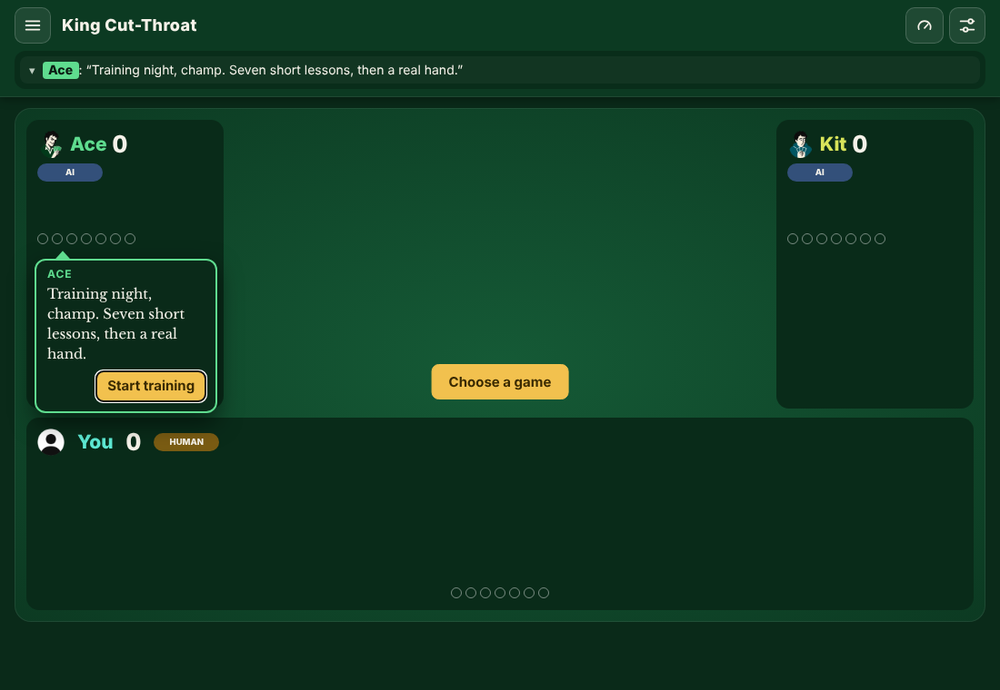
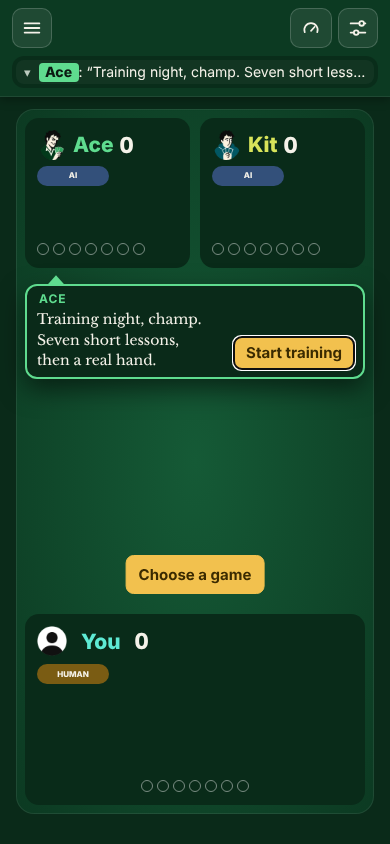
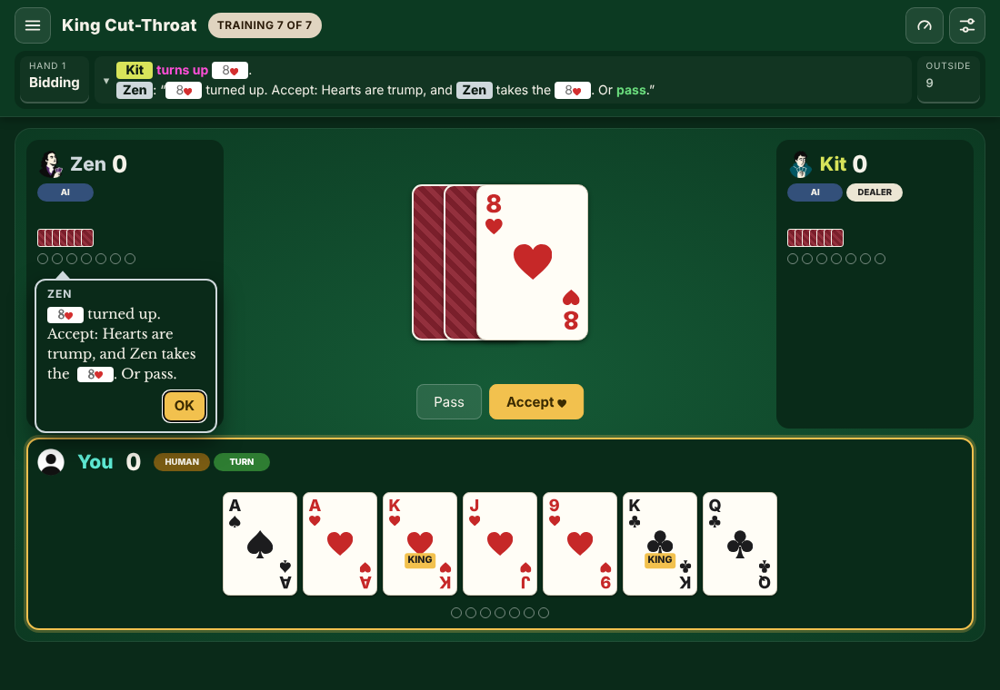
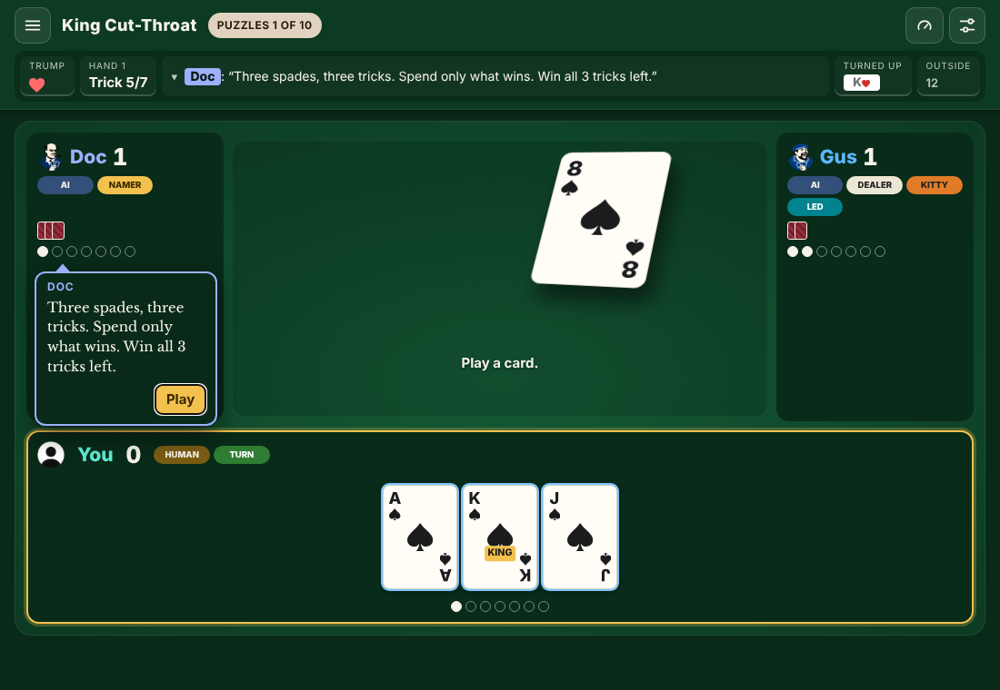
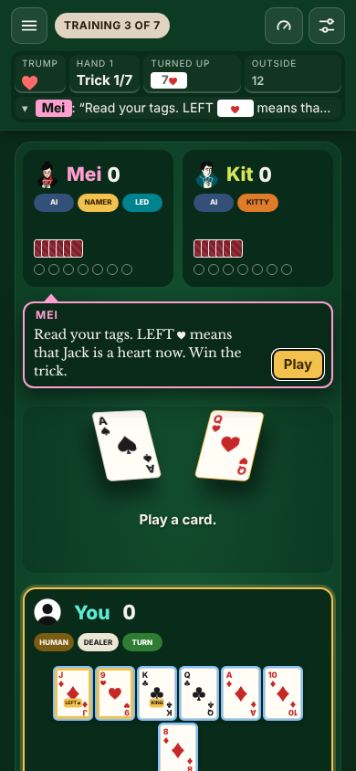
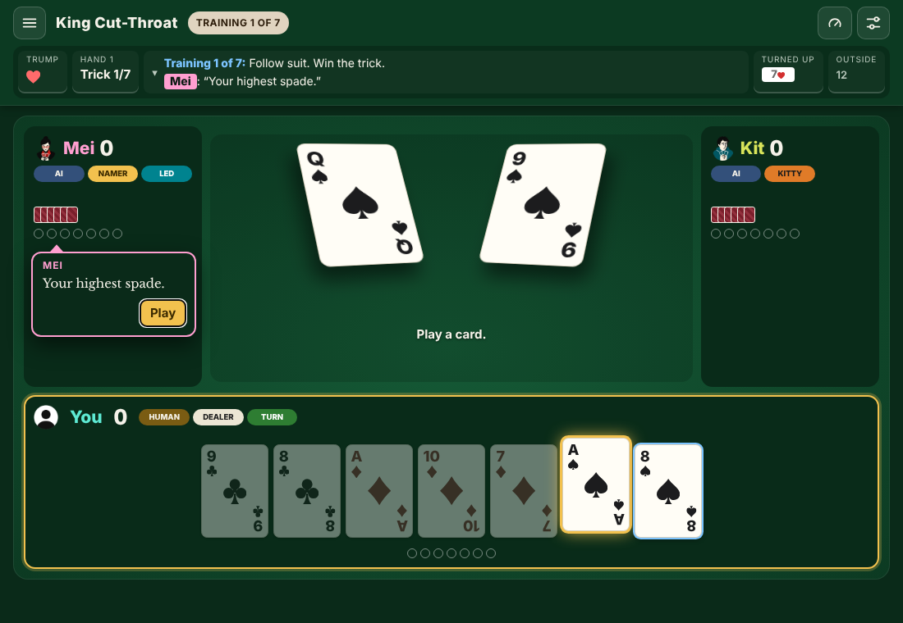
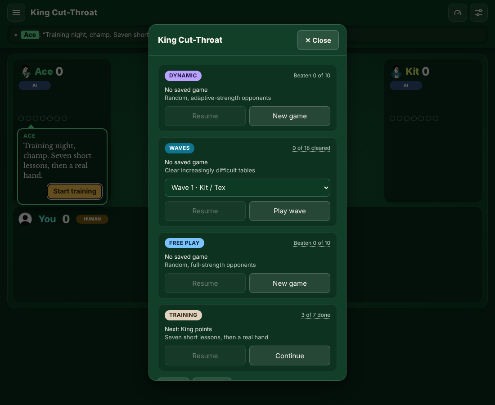

# Training and Puzzles

Training teaches a new player the table and the rules in seven short lessons, then a real hand. Finishing it opens Puzzles, the fourth mode: ten positions past the basics, for players who want more. In every lesson, two of the bots sit at the table as teachers and speak in speech bubbles from their seats. The puzzle format, the loader, the judge and the search are in [../puzzles.md](../puzzles.md).

Status: built. Revised 2026-10-19.

## Summary

- **No empty table.** The table with no game is now the lobby: two bots sit down, and one of them offers the next lesson. A first launch opens there instead of the menu.
- **Seven lessons, one idea each:** follow suit, trump, the bowers, King points, first to 10, calling trump, then a whole hand with a coach.
- **Ten puzzles past the basics,** found in real bot games by a search, each with exactly one right move.
- **Bots as teachers.** A strong bot teaches from West, and a learner asks from East. Every line is in the bot's own voice, and short.
- **Lessons keep nothing a game keeps:** no saved game, no results, no replay, no wave try. Only `kct.lessons`, the lessons done.
- **A voice, not a new look.** Only the teachers' spoken lines use a font of their own, a book serif (Libre Baskerville), so a line reads as someone talking. Everything else looks exactly as it does in a game: lessons get players used to the real table.

## Entry: the lobby

The table with no game used to be a dead end: "West 0", "East 0", one button. Now it seats two hosts:

| When | Hosts | What they offer |
|---|---|---|
| Training not finished | Ace (West) and Kit (East) | Ace: "Training night, champ. Seven short lessons, then a real hand." **Start training**, or **Continue training** with the next lesson's number. |
| Training finished | Mei (West) and Vex (East) | Mei: "Puzzles: 3 of 10 solved. Next one?" **Next puzzle**. With all ten: "All 10 puzzles solved. 👑" |

The table's own **Choose a game** button stays. The host's line also drops into the Latest line, so the information strip isn't empty.

| Wide screen | Phone |
|---|---|
|  |  |

**Launch.** A first launch opens on the lobby instead of the menu. A first launch means no saved game, no finished game, no lesson and no setting ever saved. Every other launch opens on the menu as before, with the lobby behind it.

## How it teaches

The lessons follow a few long-tested ways to teach a skill:

| Technique | Where it comes from | How the lessons use it |
|---|---|---|
| One idea at a time | Chunking and cognitive load theory (Miller; Sweller) | Each lesson is one trick, or one decision, about one rule. |
| Learn by doing, at once | Active learning; "get them playing" in game design | No reading first: two short bubbles, then you play the card. |
| I do, we do, you do | Gradual release of responsibility (Pearson and Gallagher) | Lessons 1 to 6: the teacher explains, you play one move. Lesson 7: a whole hand, with the coach. Puzzles: on your own. |
| Scaffolding that fades | Wood, Bruner and Ross | In the basics, the table's own signs are the scaffold: dimmed cards, the LEFT ♥ tag, the KING tag. The coach speaks only the first time each step comes up. Puzzles give no scaffold. |
| Immediate feedback | Behavioral and cognitive learning research | The judge decides after every step. A wrong move fails at once, even several tricks before the end, when the defence can now stop you. |
| Mastery before moving on | Mastery learning (Bloom) | A lesson is done only when solved. **Try again** costs nothing. **Hint** makes the right card glow. |
| Retrieval and interleaving | Testing effect; interleaved practice (Roediger; Rohrer) | Lesson 5 mixes trump and King points. The puzzles mix every rule again. |

## Training: the seven lessons

The chip in the header counts them, like the waves: **Training 3 of 7**.

| # | Lesson | Teacher, learner | What you do | Goal |
|---|---|---|---|---|
| 1 | Follow suit | Mei, Kit | Spades led. Win with your highest spade. The other cards are dimmed. | Win the trick |
| 2 | Trump | Mei, Kit | No spades left: any card goes, and a trump beats the Ace. | Win the trick |
| 3 | The bowers | Mei, Kit | Kit trumped with Q♥. Your J♦ is tagged LEFT ♥: it's a heart, above the Ace. | Win the trick |
| 4 | King points | Ace, Lou | The A♣ fell in trick 1, so your K♣ is the top club. Lead it. | Score a King point |
| 5 | First to 10 | Vex, Tex | You have 9. Trump with your King: the game ends mid-trick. | Score a King point (to 10) |
| 6 | Calling trump | Doc, Tex | 9♥ turned up, and you hold five hearts with both bowers. Accept. West takes the turned card. | Accept |
| 7 | Your first hand | Zen, Kit | A whole hand against them, from the discard to the score. Zen says one word at each new step. | Play the hand |

**The coach in lesson 7.** Zen speaks once, on your move, the first time each step comes up: the discard, the call (naming the turned card, and who takes it), round 2, the exchange, your first lead and your first follow, and the Showdown discard. Kit adds one aside the first time a King scores. At the end, Zen gives the hand points ("Most tricks: +1. All seven: +2 for the caller, +3 for anyone else.") and says Training is done. The buttons are **Play a game** (your highest open wave) and **Puzzles**.



## Puzzles: the fourth mode

Finishing Training turns the menu's fourth card from **Training** into **Puzzles**. **Training** stays in the menu's tools to play again. The chip counts the puzzles (**Puzzles 4 of 10**), and the card's goal counts those solved (**4 of 10 solved**). It's a nod to the game: ten points win.

| # | Puzzle | Teacher, learner | The idea |
|---|---|---|---|
| 1 | Win cheaply | Doc, Gus | Win with the lowest card that still wins. |
| 2 | A lost trick | Viv, Tex | The Joker already won: throw your least useful card, not a trump. |
| 3 | Which King? | Zen, Kit | Count the Aces: keep the King whose Ace is gone. |
| 4 | Kings pay | Ace, Lou | Aces score nothing. Throw the Ace, and let the King win later. |
| 5 | Guard the suits | Mei, Gus | Keep a card in each suit they can lead. |
| 6 | Bower last | Mei, Kit | Lead a small trump. Save the Left Bower for their Ace. |
| 7 | Spend their trump | Doc, Tex | Short on trump? Lead a side card they must trump. |
| 8 | Joker last | Vex, Lou | Make East spend the Left Bower before your Ace. |
| 9 | Guard your King | Ace, Kit | Keep a small card under the King. |
| 10 | The last trump | Vex, Doc | Make their last trump fall, and your small cards are top. |

**Where they come from.** `tests/minepuzzles.js` plays 1,500 bot games. At each of your moves in the last four tricks, the search asks what you can force against the best defence. It keeps a position when you can force the goal, few of your moves do, and the move a quick player would make does not. Out of 98 candidates, these ten have exactly one right move among three or more legal moves, and teach different ideas. The self-test checks every puzzle again: one move wins, and at least one fails.



## The bubble

**Look.** The bubble is the game's information popup with a speaker. It has the dark popup panel, and a border, a tail and a name in the speaker's bot color. Cards in the text show as the game's mini cards. When a hint names a card, that card glows gold in your hand until you play.

**Place.**

| Screen | Where | Why |
|---|---|---|
| Wide (over 720 px) | In the speaker's seat panel, under its trick circles. The tail points up at the seat. | The side panels have empty space there, so nothing on the table moves or gets covered. |
| Phone (720 px and narrower) | A row of its own between the seats and the trick: the text, with its button beside it. | The seats are short and side by side. The window fit then shrinks the cards, so your whole hand stays in view. |

| Lesson 3 on a phone | A hint: the right card glows |
|---|---|
|  |  |

**Two kinds.**

- **A stop bubble** waits for its buttons: **Next**, **Play**, **OK**, **Try again**, **Hint**, **Next**, **Again**. Your move also closes it, so you never have to click through to play.
- **An aside** (Kit's remark on a King point) fades after about 3 seconds.

One bubble shows at a time, in order. Every line also goes into the Latest Scroll as `Mei: "…"`, so a missed one can be read again.

**Access.** A stop bubble is a dialog labeled with the speaker's name. Focus moves to its main button, so Enter or Space presses it. An aside is a status line, read politely. With reduced motion, the bubble appears without its grow animation.

**The font.** Only the spoken line in a bubble uses its own font: Libre Baskerville by Impallari Type (SIL Open Font License 1.1), a book serif made for reading on screen, embedded as a 20 KB Latin subset, so it works offline. It marks the line as a voice. The bubble's name, its buttons and the whole table keep the game's font, so what a player learns looks exactly like what they will play.

## The menu

| State | Fourth card | Tools |
|---|---|---|
| Training not finished | **Training**: "New to the game? Start here", or "Next: King points". **Start** or **Continue**. Goal: **3 of 7 done**. | **Rules**, **Training** |
| Training finished | **Puzzles**: the next puzzle. **Play puzzle**. Goal: **4 of 10 solved**. | **Rules**, **Training** |

The goal in the card's corner, and the mode chip during a lesson, open the list of lessons, each with a ✓ when done. Any lesson can be played again from the list. **Resume** returns to a lesson being played.



## What the table already teaches

This audit shaped the lessons. The game already shows a new player a lot, so a basic lesson leans on it as a scaffold, and a puzzle must not be solved by it.

| What the table shows | Where in the code | What it gives away |
|---|---|---|
| **LEFT ♥**, **RIGHT** and **BEST** tags on trumps. **KING** on every King in the Advanced UI. | `cardHTML`, `cardRole` | Which cards are the bowers and the Joker, and which cards score King points. |
| A gold ring on every trump, and trumps sorted together in your hand. | `.card.trump`, `sortHand` | Which cards are trump, the Left Bower included. |
| Cards you can't play are dimmed. | `legalCards` | Following suit. |
| Clicking a trick slot: "No ♠: any card. A trump can win." | `infoPanel`, kind `slot` | That a trump wins here, but not which trump to use. |


## Rebuild the screenshots

```sh
node mockups/teacher-bubbles/shoot.js    # from the repository root; needs Playwright, as the tests do
```

## Open for later

- **Bubbles in normal games.** Bots could speak their banter lines in bubbles outside lessons too. That's a separate change.
- **More puzzles.** Run the miner with more games and add specs to `tests/data/puzzle-specs.js` (see [../puzzles.md](../puzzles.md)).
