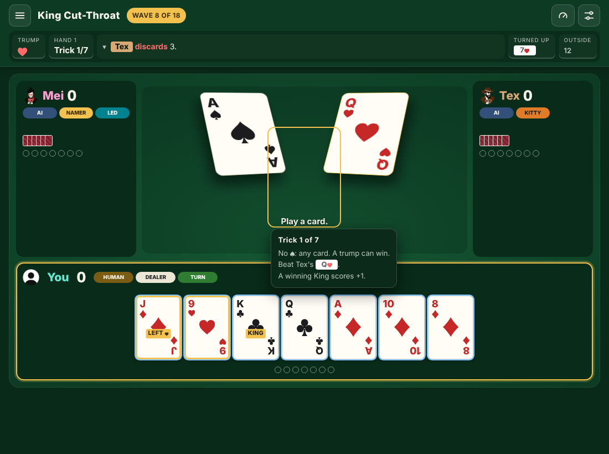
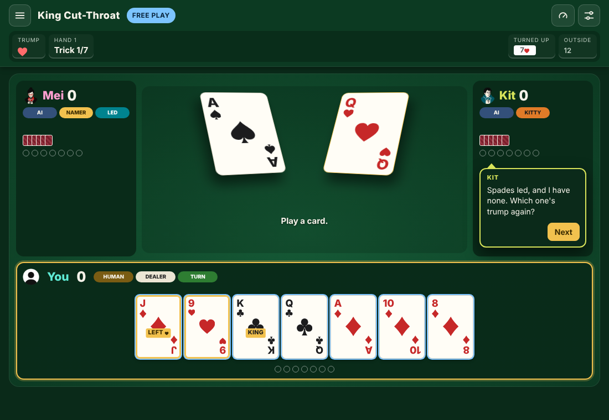
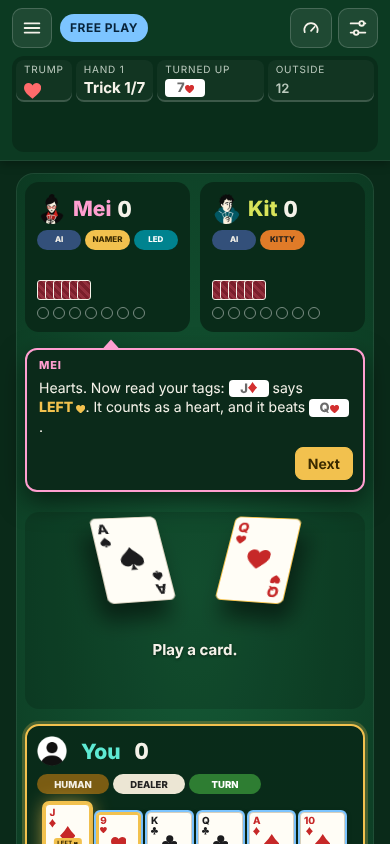

# Lessons and teacher bubbles: plan

A plan, not a spec. In a lesson, the two opponents are the teachers. They speak in speech bubbles from their seats. This page plans the lessons, the bubble, how a lesson runs, and the build order. Nothing here is built yet, except the loader and the judge ([../puzzles.md](../puzzles.md)).

Revised 2026-10-15. The first draft planned from a hand-drawn mockup. This version starts from the real table: what the game already shows a new player, measured in the app.

## Summary

- **The table already teaches.** It tags the bowers, rings every trump, dims cards you can't play, and explains each part when you click it. So a lesson can't ask "which card is the Left Bower?": the tag answers it.
- **Two kinds of lesson.** A **tour** teaches you to read the table, with nothing to get wrong. A **puzzle** asks for a decision that the table doesn't make for you. A self-test proves that each puzzle has a wrong answer that looks right.
- **The bubble is an information popup that speaks.** It reuses the popup's look, its mini cards and its dialog role. On a wide screen it sits in the speaker's own seat panel. On a phone it takes a row under the seats.
- **Lessons run in the Advanced UI.** Tours rely on its information popups, which the Flat table doesn't have.
- **Five build steps**, each its own PR with its own tests, from the defence search to the Tutorial button.

## What the table already teaches

Audited in the app with lesson 1 loaded (Advanced UI, the default, at 1100 × 760 and 390 × 844).

| What the table shows | Where in the code | What it gives away |
|---|---|---|
| **LEFT ♥**, **RIGHT** and **BEST** tags on trumps. **KING** on every King in the Advanced UI. | `cardHTML` (`index.html`, `cardRole`) | Which cards are the bowers and the Joker, and which cards score King points. |
| A gold ring on every trump, and trumps sorted together in your hand. | `.card.trump`, `sortHand` | Which cards are trump, the Left Bower included. |
| Cards you can't play are dimmed. Every interface level keeps this ([levels.md](levels.md)). | `legalCards` | Following suit. The lesson can't ask "which cards can you play?" |
| Click a trick slot: "No ♠: any card. A trump can win. Beat Tex's Q♥." | `infoPanel`, kind `slot` | That a trump wins here. It doesn't say which trump to use. |
| Click a dimmed card: "Must follow ♦: … Left Bower: it counts as ♥." | `infoPanel`, kind `illegal` | Why a card can't be played, the Left Bower case included. |
| Click the Trump cell: the trump order, highest to lowest. With **Table memory** on, also the trumps played and the trumps still out. | `infoPanel`, kind `trump` | The ranking, and the count of trumps that a careful player keeps. |

The J♦ has the LEFT ♥ tag and the gold ring, and it's sorted with the trumps. The popup says "A trump can win". (The screenshot was taken by hand: lesson 1 loaded into a wave 8 game, so Tex sits East.)

**Consequence:** the planned lesson 1 ("win this trick; only the J♦ wins") isn't a puzzle. The tag, the gold ring and the popup all point at the answer. It becomes a tour that teaches you to read those signs, which a player then uses in every game.

## Two kinds of lesson

| | Tour | Puzzle |
|---|---|---|
| Teaches | How to read the table. | A decision the table doesn't make for you. |
| You can fail | No. A wrong step gets a nudge and the step waits. | Yes. The judge decides, and **Try again** reloads the start. |
| A step ends when | You open a named popup, or make the named move. | The judge's verdict. |
| Opponents | Don't move during a step. | Play the best defence (see **How a lesson runs**). |

### Rule: no puzzle gives its answer away

A self-test checks every puzzle at its start position:

- At least one legal move solves it, and at least one legal move fails, against the best defence.
- The answer isn't the only card you can play.
- For a `decide` goal, at least one legal decision isn't in `accept`.

A puzzle that breaks the rule fails CI. It becomes a tour, or it gets a new position.

## The lessons

| # | Kind | Teacher, learner | What you do | Goal | Why the table doesn't give it away |
|---|---|---|---|---|---|
| 1 | Tour | Mei, Kit | Read the tags and the gold rings. Open the Trump cell. Win the trick with the J♦ (today's lesson 1 position). | Steps | Nothing to give away: reading the signs is the lesson. |
| 2 | Tour | Mei, Kit | ♦ is led. Click the dimmed J♦ and read why it can't be played: it counts as ♥. | Steps | Same. |
| 3 | Puzzle | Doc, Gus | ♠ is led and East trumps low. Both your A♥ and your J♦ win. Win with the cheaper card, the A♥, and keep the Left Bower. | `decide` | Both cards are legal and both win. The popup says only "a trump can win". |
| 4 | Puzzle | Ace, Lou | The A♣ is gone. Lead your K♣ to score a King point. | `score` | The KING tag says that a King can score, not when. That comes from counting. |
| 5 | Puzzle | Vex, Tex | You have 9 points. A King that wins ends the game now, mid-trick. | `winGame` | The race is read from the scores, not from any tag. |
| 6 | Puzzle | Doc, Gus | Four tricks left. Draw the last trumps, then cash your Aces. | `tricks` | The order of play is the decision. Every card is legal. |
| 7 | Puzzle | Doc, Tex | Round 1: call or pass on a clear hand. | `decide` | The game never advises a bid. |
| 8 | Puzzle | Viv, Lou | Discard 3 to build a void. | `decide`, with every good set listed | The game never advises a discard. |
| 9 | Puzzle | Zen, Kit | Win the Showdown. | `score` | Needs a fixed Showdown deal: format 2. |

Positions 2 to 9 are still to be authored. The self-test above decides whether each one stands.

## The bubble

### Built on the information popup

The Advanced UI's information popup (`.panel`, `showPanel`) already has most of what a bubble needs:

- A dark panel in the table's style.
- Mini cards in the text (`Render.microHTML`).
- A dialog role, and placement that stays inside the window.
- One way to close it (`closePanel`).

The bubble is that panel plus a speaker:

- **Border and tail** in the speaker's persona color. Every persona color is light, so the name reads well on the dark panel, as it does on the seat names.
- **Name line** at the top: the speaker's name, small capitals, in the persona color.
- **Text:** at most 2 sentences. Cards render as mini cards. A tag named in the text (**LEFT ♥**) is gold, as on the card.
- **Pointer:** the card the teacher means gets a gold glow and lifts, as a hovered card does.

### Placement, measured

| Screen | Where | Why |
|---|---|---|
| Wide (over 720 px) | Inside the speaker's seat panel, under the trick circles. The tail points up at the seat. | Each side panel has about 180 px of empty height under the circles at 1100 × 760. Nothing on the table moves or gets covered. |
| Phone (720 px and narrower) | A row of its own between the seats and the trick. The table moves down. | The seat panels are short and side by side, and the trick fills the center. The Latest Scroll already pushes the table down the same way. |

On a phone, the extra row pushes your hand below the window (see `phone-2-mei-answers.png`). The bubble must run the window fit (`Fit.update`) when it opens and closes, so that the cards shrink as they do for a tall header. **Check:** at 390 × 844, your whole hand stays in view while a bubble shows.

| Wide: the learner asks | Phone: the teacher answers |
|---|---|
|  |  |

The solved bubble is in `desktop-3-solved.png`. These are screenshots of the real app with lesson 1 loaded. Only the bubble and the gold glow are the prototype. `node mockups/teacher-bubbles/shoot.js` rebuilds them. In these shots, the Latest line is hidden, because it belongs to the game that the script started first.

### Two kinds of bubble

| Kind | When | Behavior |
|---|---|---|
| **Stop** | The intro, a tour step, the verdict, a hint. | Play waits. The buttons are in the bubble: **Next**, or **Try again**, **Hint**, **Next lesson** and **Lessons**. Space or Enter presses the main button. |
| **Aside** | A remark during play. | Play goes on. It fades after about 3 seconds. A click closes it. |

One bubble at a time, in a queue. Opening an information popup doesn't close a stop bubble, because a tour asks you to open one.

### Access and motion

- A stop bubble is a non-modal dialog, labeled by the speaker's name. Focus moves to its main button, and goes back to the table when it closes.
- An aside goes to a polite live region.
- Every line also goes to the Latest Scroll as `Mei: "…"`, as the Dynamic read lines do, so a missed line can be read again.
- It grows from the tail in about 150 ms. With reduced motion or the Instant speed, it appears at once.

## How a lesson runs

A lesson is a new app mode, `lesson`, next to Free play, Dynamic and Waves.

- **Starts from the loader.** It seats the two personas, puts their names on the seats, and opens on the start position. The bubble queue plays the intro.
- **Touches nothing that a game keeps.** No save slot, no results, no replay code, no wave tries, no Dynamic profile, no backup. Its only storage is the list of lessons solved, `kct.lessons`.
- **Opponents in a puzzle.** They play the best defence: a full search over the open hands, with the opponents working together against your goal. The loader keeps each search small: a puzzle starts with at most 4 main tricks left, or 5 Showdown tricks. That is fewer than 15,000 lines of play (4! × 4! × 4! = 13,824 for the main tricks; 5! × 5! = 14,400 for a Showdown).
- **The judge** runs after every step, and the first verdict that isn't open ends the puzzle.
- **Tour steps** wait on one of two events:
  - An information popup of a named kind opening. This takes one hook in `showPanel`.
  - A named move.

  A wrong move in a tour is undone, and the learner says why.
- **Leaving.** The menu works as in a game. Leaving a lesson costs nothing.
- **Interface:** a lesson always uses the Advanced UI and puts your setting back after. Tours need its information popups.

## Data: format 2

Format 2 adds four optional fields to format 1.

| Field | Type | Meaning |
|---|---|---|
| `teachers` | `{ "west": id, "east": id }` | The two personas. A lesson always seats them. |
| `talk` | object | The lines: `intro`, `hint`, `solved`, and `failed` by judge reason. Each line is `[seat, text]`, where `seat` is `west` or `east`. |
| `steps` | list | A tour's steps. Each step is `{ "say": [lines], "wait": { "open": kind } }` or `{ "say": [lines], "wait": { "play": card } }`. A tour has `steps` and no `goal`. |
| `showdownDeal` | `{ "hands": … }` | The fixed Showdown deal, for lesson 9. |

In the text, `{JD}` is a mini card. The loader checks the following:

- Every card and every seat is real.
- The judge has a line for every reason that the goal can produce.
- In a tour, every `wait.open` names a popup kind that exists.

## Build steps

Each step is its own PR. A step's checks must pass before the next step starts.

| Step | What | Checks | Size |
|---|---|---|---|
| 1 | **Defence search**, and the self-test that no puzzle gives its answer away. Loader limits on the tricks left. | Every puzzle is solved by its answer and failed by at least one wrong move. A known position gives a known best line. | M |
| 2 | **Lesson mode** in the app: start, judge each step, Try again, leave. No UI for the lines yet. | A new UI test, `tests/lessons.js`: plays lesson 1 through the controls, then checks that no save, result, replay or wave try was written. | M |
| 3 | **Bubble component**: the two kinds, the queue, placement, mini cards, the pointer, the window fit, and access. | The test drives a stop and an aside on a wide screen and on a phone. At 390 × 844, the hand stays in view. The self-tests check the live region. | M |
| 4 | **Format 2** and the tour steps, with the `showPanel` hook. | Loader self-tests for the new fields. The tour of lesson 1 runs end to end in the UI test. | S |
| 5 | **The lessons** and the Tutorial button: positions 2 to 9, the lines, the lessons list and `kct.lessons`. | The no-giveaway self-test passes for every puzzle. The UI test solves and fails each lesson once. | L |

## Risks

| Risk | Plan |
|---|---|
| A lesson writes to a game's save or results. | Lesson mode never calls the save, stats, replay or wave code. Step 2's UI test checks every key. |
| On a phone, the bubble pushes the hand out of view. | The bubble runs the window fit. Step 3's check is at 390 × 844. |
| The defence search is slow. | The loader limits the tricks left. The self-test times each puzzle's search. |
| A future change to the table, such as a new tag, gives away a puzzle's answer. | The no-giveaway self-test runs in CI on every PR. |
| The lines don't sound like the bots. | They are data, so changing them changes no code. They follow [../banter.md](../banter.md). |

## Decisions for you

1. **Tours and puzzles.** Lessons 1 and 2 become tours, because the table already shows their answers. Recommended: yes.
2. **Advanced UI only.** Should lessons always use the Advanced UI? Recommended: yes, because tours need its popups. Your Interface setting stays as it is.
3. **The pairs** in the lessons table. Each pair is data and easy to change.
4. **Banter outside lessons.** Should bots also speak in bubbles in normal games? Recommended: not now. It's a separate change, after lessons ship.
